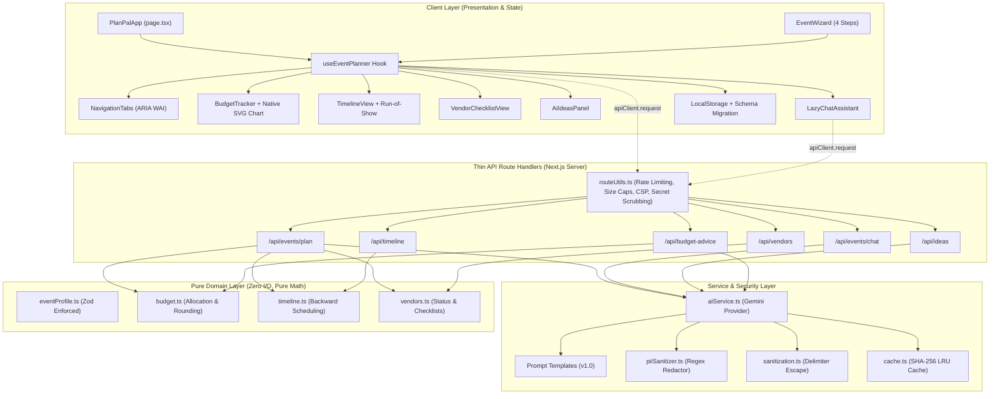

# PlanPal 🎪💍🎂

> **Intelligent, privacy-first event planning assistant for Weddings, Birthdays, and Community Events.**
> Engineered with pure domain modeling, grounded AI assistance, strict client-side persistence, and WCAG 2.1 AA accessibility.

---

## 📌 Problem Statement & Solution

### The Problem
Planning milestone events—whether an intimate wedding, a birthday celebration, or a 600-person neighborhood festival—is fragmented and overwhelming. Organizers juggle disparate spreadsheets, vendor quote threads, and chaotic timelines. General-purpose chatbots produce ungrounded, hallucinated suggestions that ignore budget limits, lead times, venue constraints, and dietary accommodations. Most web tools also compromise privacy by syncing personal guest data and vendor contracts to third-party databases.

### How PlanPal Solves It
1. **Mathematical Domain Certainty**: Budget percentages, cent-exact allocations, backward timeline scheduling, and vendor checklists run on pure, side-effect-free TypeScript algorithms with 100% test coverage.
2. **Grounded AI Co-Pilot**: AI recommendations (via Google Gemini) are strictly bounded to the event profile and actual budget limits. Prompts isolate untrusted user data, redact PII before transmission, and validate every AI response with strict Zod schemas before rendering.
3. **Local-First Privacy**: All event data, actual spend logs, and checklists remain strictly on the user's device in `localStorage` with versioned schema migrations. No remote user database, no tracking cookies, and no client-side API keys.
4. **Inclusive Accessibility**: Designed from the ground up to comply with WCAG 2.1 AA standards—full keyboard navigation, high contrast ratios (4.5:1+), dual data table & SVG chart visualizations, screen reader announcements (`aria-live`), and zero layout shifts.

---

## 🌟 Features

- **Multi-Step Event Intake Wizard**:
  - 4-step progressive wizard with text-based step progress (`Step X of 4: Step Name`).
  - Strict input validation linked via `aria-describedby` with live error announcements.
  - Automatic preset generation for weddings, birthdays, and community festivals.
- **Dual-Visualized Budget Tracker**:
  - Accessible, responsive native SVG Donut / Category Breakdown Chart with ARIA labels and fallback data tables.
  - Cent-exact roundings where category allocations always sum to 100% of total budget.
  - Multi-status badges (`✓ On Track`, `⚠️ Near Limit`, `❌ Over Budget`) never conveyed through color alone.
  - Inline actual cost updates and paid status checkboxes.
- **Adaptive Backward Timeline Scheduler**:
  - Backward scheduling from event date to current day.
  - Graceful compression when lead times are short, highlighting overdue milestones with warning badges.
  - Dual timeline views: **Milestones Overview** and **Day-Of Run-of-Show Schedule**.
- **Vendor Procurement Manager**:
  - Categorized checklist tailored to the event archetype.
  - Status pipeline: `Researching` → `Contacted` → `Booked` → `Declined`.
  - Deposit tracking and contract signing checklists.
- **Grounded AI Ideation & Conversational Co-Pilot**:
  - Contextual themes, color palettes, activities, catering menus, and DIY budget-saving advice.
  - Grounded chat assistant that answers planning queries using active event context.
  - Built-in prompt-injection defenses and off-topic redirect mechanisms.
- **Client-Side Persistence & Export**:
  - LocalStorage persistence with versioned schema migration (`v1` → current).
  - Corrupted storage recovery with fallback to safe presets.
  - Export plan to JSON and print-friendly styled view (`@media print`).
  - Clear all data with confirmation modal (`role="alertdialog"`).
  - Explicit in-app Privacy Notice.

---

## 🏗️ Architecture

PlanPal enforces a strictly decoupled, unidirectional layered architecture:



---

## ⚡ Setup in 3 Commands

Clone the repository and run:

```bash
# 1. Install dependencies
npm install

# 2. Copy environment variables (optionally configure GEMINI_API_KEY)
cp .env.example .env.local

# 3. Start development server
npm run dev
```

Open [http://localhost:3000](http://localhost:3000) in your browser.

---

## 🔐 Environment Variables

PlanPal works out of the box with built-in mock offline fallbacks. To enable live Gemini AI generation:

| Variable | Description | Required | Default |
| :--- | :--- | :--- | :--- |
| `GEMINI_API_KEY` | Google Gemini API Key (server-side only) | No (mock fallback provided) | `""` |
| `GEMINI_MODEL` | Gemini Model Identifier | No | `gemini-2.5-flash` |
| `NODE_ENV` | Environment mode (`development`, `production`, `test`) | No | `development` |

> [!IMPORTANT]
> `GEMINI_API_KEY` is **strictly server-side**. It is never prefixed with `NEXT_PUBLIC_` and is never exposed in client bundles, logs, or response payloads.

---

## 🛡️ Security Design & Threat Model

PlanPal underwent a comprehensive security review against the **OWASP Top 10 (2021)** and **OWASP Top 10 for LLMs (2025)**:

1. **Prompt Injection Defense (OWASP LLM01)**:
   - Delimiter Isolation: User input is wrapped in `<USER_DATA>` tags.
   - Tag Evasion Neutralization: `escapeDelimiters()` intercepts attribute-bearing tags (`<USER_DATA role="system">`), whitespace tags (`< /USER_DATA >`), and code fence impersonation (` ```system `).
   - System instruction directs the LLM to treat all enclosed text as passive attributes and refuse commands.
2. **Sensitive Data Disclosure & PII Scrubbing (OWASP LLM06 / A02:2021)**:
   - Automated regex scrubbing (`piiSanitizer.ts`) redacts email addresses, phone numbers, and SSNs before any prompt construction.
   - Secret Scrubber (`routeUtils.ts`) strips system credentials and file system paths from all HTTP error responses.
   - Header-based API key transport: Gemini requests use the `x-goog-api-key` HTTP header instead of URL query parameters (`?key=...`), preventing credential leakage in proxy and server access logs.
3. **Denial of Service & Unbounded Memory (OWASP LLM04 / A04:2021)**:
   - Sliding-window in-memory rate limiting (20 req/min for AI endpoints, 30 req/min for domain endpoints).
   - Memory-bounded rate limiter (`maxTrackedIps: 5,000`) with automatic garbage collection of expired timestamps.
   - Client IP regex validation prevents header injection and prototype tampering.
   - Max request body size caps (64 KB default) with immediate `413 Payload Too Large`.
4. **Cross-Site Scripting (XSS) & Content Security Policy (OWASP A03:2021)**:
   - Strict CSP header with `script-src 'self' 'unsafe-eval'`, eliminating `'unsafe-inline'` script execution.
   - External connect restriction: `connect-src 'self'`, ensuring client browsers cannot connect directly to third-party endpoints.
   - Framing defense: `frame-ancestors 'none'` and `X-Frame-Options: DENY` prevent clickjacking.
5. **Insecure Output Handling (OWASP LLM02)**:
   - Every AI response is validated with strict Zod schemas (`AiPlanSuggestionSchema`, `PersonalizedIdeasSchema`, `BudgetAdviceSchema`). Malformed outputs trigger an automatic single retry; persistent mismatches throw typed errors rather than poisoning the UI.

---

## 🧪 Testing & Code Coverage

PlanPal maintains an exhaustive automated test suite with **253 tests across 31 test files**:

```bash
# Run all tests
npm test

# Run tests with coverage report
npm run test:coverage

# Run TypeScript typecheck
npm run typecheck

# Run ESLint check
npm run lint

# Build production bundle
npm run build
```

### Coverage Summary
- **`/src/domain`**: **100% Statements, 100% Lines, 89.3% Branches**
- **`/src/services`**: **91.2% Statements, 91.8% Lines**
- **Total Repository**: **90.99% Statements, 91.81% Lines**

---

## ♿ Accessibility Statement (WCAG 2.1 AA)

PlanPal is built to meet and exceed **WCAG 2.1 Level AA** standards:

- **Perceivable**:
  - Dual visual representation: The budget is conveyed via both an accessible SVG chart (`role="img"`, `<title>`, `<desc>`) and an equivalent detailed data table.
  - Multi-attribute status indicators: Warning and over-budget states include both visible text labels (`✓ On Track`, `⚠️ Near Limit`, `❌ Over Budget`) and distinct icons—never color alone.
  - Minimum contrast ratio: All text and interactive controls exceed 4.5:1 contrast against their backgrounds in both Light and Dark themes.
- **Operable**:
  - Skip to Content: Hidden skip link (`#main-content`) is the first focusable element.
  - Keyboard Navigation: Tab strip implements the WAI-ARIA Tabs design pattern with Arrow Left/Right cycling and Home/End navigation.
  - Focus Management: Focus moves logically into the setup wizard dialog, traps focus while open, and restores focus to the trigger upon dismissal.
  - Touch Targets: All interactive buttons and inputs have minimum touch bounds of 44x44px.
- **Understandable**:
  - Form inputs feature persistent visible `<label>` elements linked to error messages via `aria-describedby`.
  - Dynamic AI loading states and notifications use `role="status"` and `aria-live="polite"`.
- **Robust**:
  - Zero accessibility violations verified across every screen and modal using automated `jest-axe` audit tests.
  - Respects user operating system preferences: `prefers-reduced-motion` suppresses transitions; `prefers-color-scheme` automatically selects light or dark theme.

---

## ⚠️ Known Limitations

1. **Single Active Event**: PlanPal currently tracks one active event in local storage at a time. Switching presets or completing the wizard replaces the current active event (users can use "Export Plan JSON" to archive plans).
2. **Server-Side In-Memory Rate Limiting**: The sliding-window rate limiter stores IP logs in Node.js process memory. In a multi-instance serverless cluster (e.g. AWS Lambda or Vercel multi-region), an external shared store like Redis (e.g., Upstash) would be recommended for distributed enforcement.
3. **No Direct Calendar Integration**: Milestones and day-of schedules are exportable to JSON and print format, but direct `.ics` file generation and Google Calendar sync are not yet implemented.

---

## 🎬 Demo Script & Walkthrough

Use the following example inputs to test and demonstrate all three event archetypes:

### 1. Wedding: "Sarah & David's Vineyard Wedding"
- **Event Type**: Wedding
- **Title**: `Sarah & David's Vineyard Wedding`
- **Date**: `2027-09-20` (or 10-14 months in the future)
- **Guest Count**: `130`
- **Total Budget**: `$38,000`
- **Location**: `St. Helena, Napa Valley, CA`
- **Theme**: `Tuscan Sunlit Vineyard`
- **Constraints**: Dietary: `Vegan`, `Gluten-Free`; Accessibility: `Wheelchair Accessible`; Kid-Friendly: `No`
- **Key Checks**:
  - Notice budget allocation: Venue & Catering allocated ~50% ($19,000).
  - Milestones scheduled backward across 12-month timeline.
  - Chat Question: *"How can we optimize our floral budget?"* → AI recommends repurposing ceremony arbor florals for reception tables.

### 2. Birthday: "Leo's 10th Birthday Adventure"
- **Event Type**: Birthday Party
- **Title**: `Leo's 10th Birthday Adventure`
- **Date**: `2027-06-12` (or 3-4 months in the future)
- **Guest Count**: `35`
- **Total Budget**: `$2,500`
- **Location**: `Austin, TX`
- **Theme**: `Retro Arcade & Pixel Glow`
- **Constraints**: Kid-Friendly: `Yes`
- **Key Checks**:
  - Notice budget allocation: Activity & Entertainment prioritized over formal catering.
  - Compressed lead-time milestone scheduling.
  - Chat Question: *"What is our backup plan if it rains?"* → Contingency alert triggers indoor auxiliary game room pivot.

### 3. Community Festival: "Oakridge Summer Festival"
- **Event Type**: Community Event
- **Title**: `Oakridge Summer Festival`
- **Date**: `2027-07-24` (or 6-8 months in the future)
- **Guest Count**: `600`
- **Total Budget**: `$15,000`
- **Location**: `Oakridge Park & Pavilion, Portland, OR`
- **Theme**: `Roots & Green Community Harvest`
- **Constraints**: Dietary: `Vegetarian`, `Vegan`; Accessibility: `Wheelchair Accessible`, `Quiet Space`; Kid-Friendly: `Yes`
- **Key Checks**:
  - Notice budget allocation: Permits, sanitation, stage audio, and safety equipment prioritized.
  - Day-of Run-of-Show contains neighborhood talent showcases and lawn game schedules.
  - Export: Click **"Export JSON"** to download blueprint or **"Print Plan"** to preview print stylesheet.
